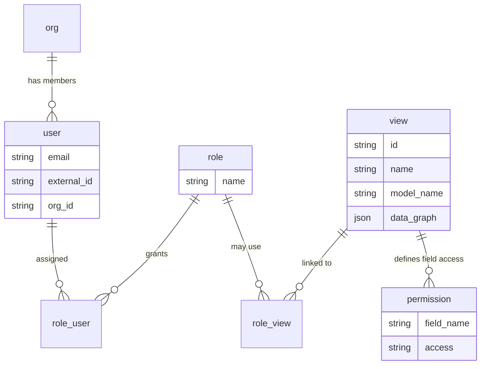

# Authentication and Authorization

**When to read**: Understanding how Fabriq Books identifies users, enforces access, and isolates tenant data — without diving into source code.

**Audience**: Technical readers (engineers, solution architects, operators) who need a clear mental model.

**Related docs**:
- [AUTHENTICATION.md](./AUTHENTICATION.md) — provider setup, adapters, migration, and implementation detail
- [WORKFLOWS.md](./WORKFLOWS.md) — approval states, assignments, and workflow-driven fields
- [BACKEND.md](./BACKEND.md) — API routes and backend conventions
- [DEPLOYMENT.md](./DEPLOYMENT.md) — bootstrapping roles, views, and permissions
- [ARCHITECTURE.md](./ARCHITECTURE.md) — end-to-end request flow

---

## Overview

Fabriq Books separates **authentication** (who you are) from **authorization** (what you may see and change).

| Layer | Question answered | Mechanism |
|-------|-------------------|-----------|
| **Authentication** | Is this a valid user? | Pluggable auth adapters; JWT-style tokens (local or Clerk) |
| **Authorization** | What data and fields may this user access? | Role-based access through **views** and **permissions** |
| **Tenant isolation** | Which organization’s data applies? | Every business user belongs to an **org**; queries are scoped by `org_id` |

After authentication succeeds, the system loads the user’s roles, merges permissions from all assigned views, and applies that map on every API operation. Business data is never returned outside the user’s organization.

---

## Part 1 — Authentication

### JWT-based identity

Clients prove identity by presenting credentials that resolve to a **signed token** (JWT for local auth; Clerk-issued session tokens for production). On each API request, the backend:

1. Validates the token through the configured **auth adapter**
2. Resolves the token to an identity (`external_id` from the provider)
3. Looks up the matching row in the Fabriq **`user`** table (must exist and have an `org_id`)
4. Loads **permissions** for that user (authorization begins here)

If any step fails, the request is rejected — there is no anonymous access to business APIs.

### Pluggable adapter system

Authentication is **provider-agnostic**. A single environment setting (`AUTH_PROVIDER`) selects which adapter validates incoming requests. All adapters implement the same contract: verify the request, return identity claims, and let the shared pipeline attach the Fabriq user and permissions.

```
┌─────────────┐     ┌──────────────────┐     ┌─────────────────┐
│   Client    │────▶│  Auth adapter    │────▶│  Fabriq user    │
│  (browser,  │     │  (local / clerk) │     │  lookup + perms │
│   script)   │     └──────────────────┘     └─────────────────┘
└─────────────┘
```

| Provider | Status | Intended use |
|----------|--------|----------------|
| **`local`** | Implemented | **Development and demos only.** Email/password login; Fabriq signs JWTs with `JWT_SECRET`. Not recommended for production (no hosted IdP, password management, MFA, or centralized session revocation). |
| **`clerk`** | Implemented — **only supported production adapter today** | Hosted identity: sign-in UI, MFA, org-aware users. Token verified by Clerk; user matched in Fabriq by `external_id` (Clerk user id). |
| **Other** (`auth0`, `cognito`, SuperTokens, etc.) | Not implemented in the adapter factory | Same **pattern** as Clerk is intended for future providers; configuration and code changes are required before use. |

**Production guidance:** Set `AUTH_PROVIDER=clerk` and configure Clerk keys. Use `local` only for local workstations, CI, or seeded demo environments.

For adapter configuration, env vars, and migration notes, see [AUTHENTICATION.md](./AUTHENTICATION.md).

### Linking external identity to Fabriq

Regardless of provider, a person using the app must have a **`user`** record that includes:

- **`external_id`** — stable id from the auth provider (Clerk user id, or email-derived id for local)
- **`org_id`** — organization membership (required for data access)
- **`auth_provider`** — which provider created the session (`local`, `clerk`, …)

Login establishes identity; authorization is applied afterward using roles and views (Part 2).

### Request lifecycle (functional)

```
1. Client sends request with Authorization: Bearer <token>
   (or X-Api-Key for programmatic access — see Other access paths)

2. Auth adapter validates token → external identity

3. Database: user WHERE external_id = <identity>
   → fail if missing or org_id is null

4. Load merged permissions for user.id

5. Route handler runs with { user, permissions }
```

The React app typically stores the session (cookie or client state) and sends the bearer token on API calls to port **4000**.

---

## Part 2 — Authorization (RBAC)

### Core idea: views, not direct model grants

Fabriq does **not** attach permissions directly to users per model. Instead:

- **Roles** are named job functions (e.g. Finance Team, Buyer, Super Admin).
- **Views** define how a **single model** is exposed: which fields and relations appear, and what access level each field has.
- **Role–view assignments** connect roles to the views those users may use.

A user may hold **multiple roles**. Permissions from every view linked to those roles are **merged**, taking the **most permissive** access per field (`write` beats `read` beats `none`).

### Entity model



| Entity | Role in RBAC |
|--------|----------------|
| **org** | Tenant boundary; users and business data belong to one org. |
| **user** | Person using the system; linked to auth provider via `external_id`. |
| **role** | Named permission bundle (e.g. Administrator, Finance Team). |
| **role_user** | Many-to-many: which users have which roles. |
| **view** | Per-model “lens”: shape of data (`data_graph`) + attached permissions. |
| **role_view** | Many-to-many: which roles may use which views. |
| **permission** | Per-field rule on a view: `read`, `write`, or `none`. |

Roles do not grant access to models by themselves — only through **views** assigned via `role_view`.

### What is a view?

A **view** is the central authorization and presentation object for a model (e.g. `invoice`, `posting`, `supplier`).

Each view has:

| Property | Purpose |
|----------|---------|
| **`model_name`** | Which Prisma / business model this view applies to. |
| **`name` / `id`** | Identifier used in URLs and configuration (e.g. `invoice_view`). |
| **`data_graph`** | Which fields and nested relations are selected for lists, forms, and API responses — the **shape** of data the client may request. |
| **`permissions`** | Field-level access rows (`field_name` + `access`). |

Think of it as two layers on one object:

1. **`data_graph`** — *what can appear* (columns, form fields, related records).
2. **`permissions`** — *what the user may do* with those fields (`read` vs `write`).

The application’s primary API path includes the view id:

```
/api/{model}/view/{viewId}
/api/{model}/view/{viewId}/search
```

Using a view ensures both **shape** and **access** are evaluated together. Different roles often use different views on the same model (e.g. `invoice_readonly_view` vs `invoice_finance_view`).

UI metadata in `data_graph` may also mark fields with `permission: "read"` or `"update"` for forms; those align with the view’s permission rows. See [datagraph-builder/DATAGRAPH_SCHEMA_REFERENCE.md](./datagraph-builder/DATAGRAPH_SCHEMA_REFERENCE.md).

### Field-level authorization

Each **permission** row belongs to one view:

| `field_name` | `access` | Meaning |
|--------------|----------|---------|
| `amount` | `read` | User may see `amount` but not change it on write. |
| `status` | `write` | User may read and update `status`. |
| `internal_notes` | `none` | Field is denied (omitted or blocked). |
| `*` | `read` or `write` | **Wildcard** — applies to all fields on that model for this view. |

**Enforcement (conceptual):**

- Before a read or search, the system checks the user has at least **read** (or **write**) on the model for the operation.
- Requested fields must be allowed; response payloads are **filtered** to permitted fields.
- Creates and updates validate each written field against **write** (or wildcard write).

### Multi-role merge

When a user has more than one role, Fabriq loads all `role_view` → `view` → `permission` chains and builds one map per model:

```
permissions[model_name][field_name] → 'read' | 'write' | 'none'
```

**Merge rule:** For the same model and field, the **highest** access wins:

```
write  >  read  >  none
```

If any assigned view grants wildcard `*` with `write`, that view can confer broad access for that model (subject to how views are configured for that role). Operators should design roles so that combined assignments reflect intended least privilege — e.g. a “read-only auditor” role and a “finance editor” role together yield editor access on overlapping fields.

### Tenant isolation (`org_id`)

Multi-tenancy is enforced at the **data** layer:

- Each user has an **`org_id`** (organization).
- Business records carry **`org_id`**; queries automatically restrict results to the authenticated user’s organization.

A user in Org A cannot list or modify Org B’s invoices, postings, or suppliers — regardless of role name — because the data layer scopes by `org_id` in addition to RBAC.

### Audit and workflow fields (related, not RBAC)

Most business models include standard **audit** columns for traceability:

- `created_at`, `modified_at`
- `created_by`, `modified_by`

These support compliance and debugging; they are not a substitute for permission checks.

**Workflow-enabled** models add state and ownership fields (e.g. `status`, `wf_instance_id`, `assigned_to`, and relations to workflow history). Who may **transition** a document between states depends on the **workflow engine** (role- or user-assigned states), which is separate from view-based field RBAC. For states, actions, and assignments, see [WORKFLOWS.md](./WORKFLOWS.md).

---

## Part 3 — How authorization is applied end-to-end

```
Authenticated user + permissions map
        │
        ▼
API request names model + viewId
        │
        ▼
Load view (data_graph + permission rows)
        │
        ▼
Validate operation (read / write) on model
        │
        ▼
Validate each field in request against permissions
        │
        ▼
Execute query with org_id scope
        │
        ▼
Filter response fields to permitted set
        │
        ▼
Return data + view metadata to client
```

The same permission map is used for **GraphQL** (secondary API), **imports**, and **AI agent** tools that call through the standard data layer — so agents cannot bypass views by design.

---

## Other access paths

| Path | Authentication | Authorization |
|------|----------------|---------------|
| **Browser / SPA** | Bearer token from local login or Clerk session | Full RBAC via views; UI routes reference `viewId` |
| **API key** (`X-Api-Key` header) | Hashed key on `user.api_key`; resolves to that user | Same `getUserPermissions` as JWT — no elevated bypass |
| **AI agent** (`/api/agent/*`) | Same middleware as REST | Tools use `ModelService` and SQL paths that respect org and permissions |
| **MCP** (`/api/mcp`) | Same as API | Intended for integrated clients; subject to same user context |

API keys are suited to **automation** (scripts, integrations) acting as a specific user, not for shared secrets across tenants.

---

## Configuring access (operators)

Typical setup flow:

1. **Bootstrap** — `setup-db.js` / metadata scripts create standard roles, views, permissions, and `role_view` links ([DEPLOYMENT.md](./DEPLOYMENT.md)).
2. **Adjust** — Edit view JSON under `backend/prisma/metadata/views/` and sync (`npm run sync-metadata` or admin dev-options where enabled).
3. **Assign users** — Link users to roles (`role_user`) via admin UI or SQL.
4. **Verify** — Sign in as test users and confirm list/form fields match expected read/write behavior.

Settings UI routes (frontend): **Views** and **Permissions** under `/settings/`.

---

## Quick reference

| Topic | Document |
|-------|----------|
| Clerk / local setup, env vars | [AUTHENTICATION.md](./AUTHENTICATION.md) |
| Approval workflows | [WORKFLOWS.md](./WORKFLOWS.md) |
| Add model + view + permissions | [BACKEND.md](./BACKEND.md), [DEPLOYMENT.md](./DEPLOYMENT.md) |
| Debug permission SQL | [CLAUDE.md](./CLAUDE.md) (Quick Debugging) |

---

## Implementer note

Low-level behavior (wildcard edge cases, `SKIP_PERMISSION_CHECKS`, method-level API) is documented in `backend/src/services/permissions/PermissionService.md` for developers maintaining the permission engine. That file is intentionally separate from this guide.
