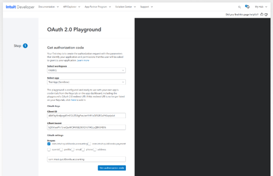
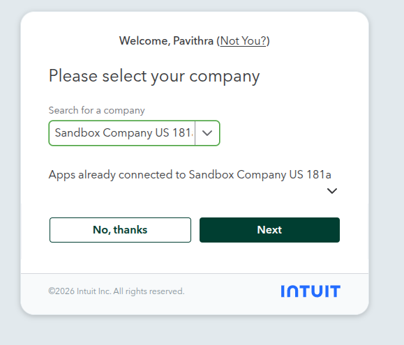
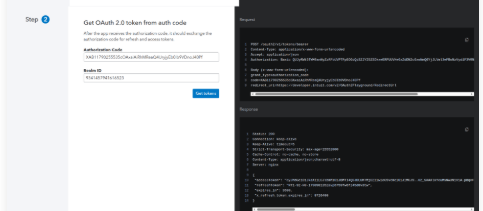
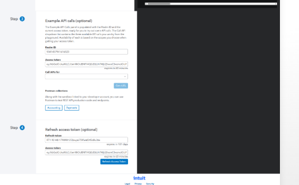
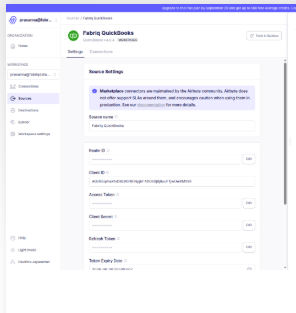
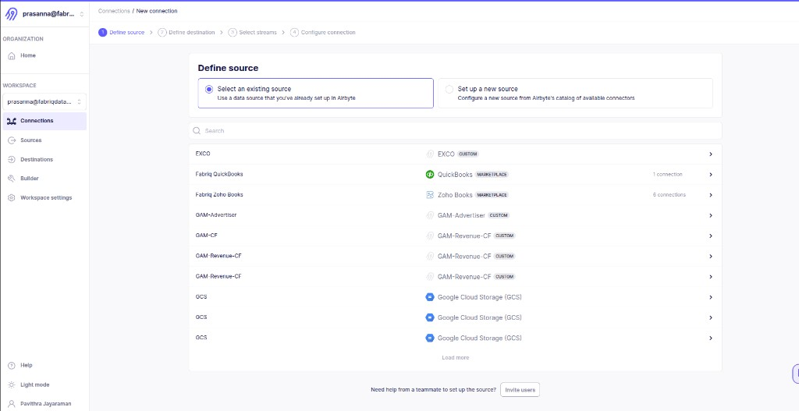
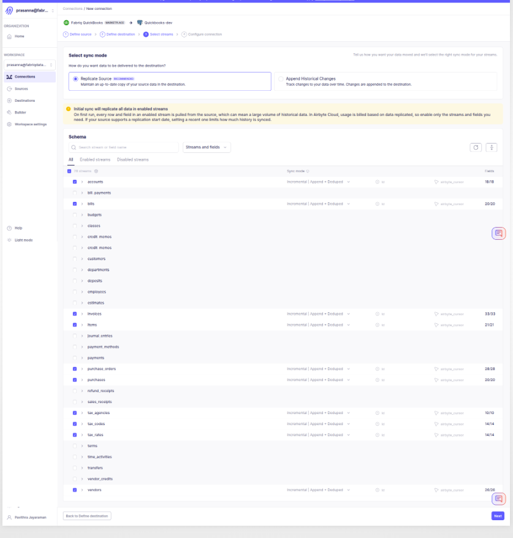
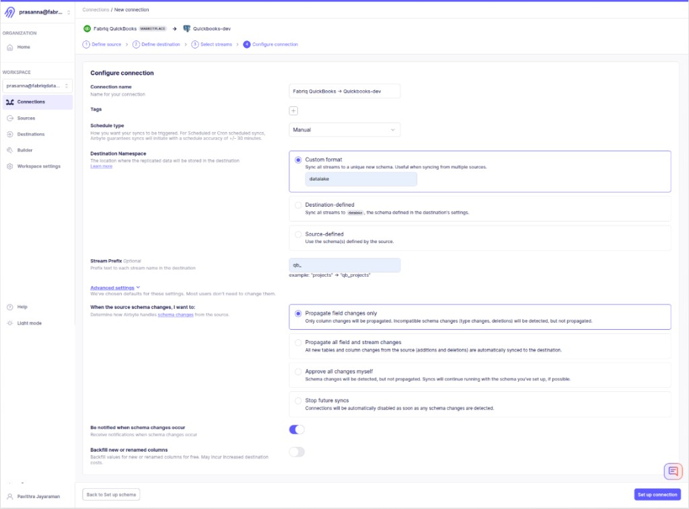
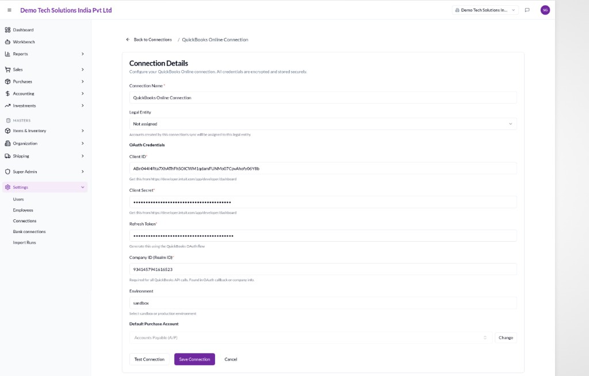
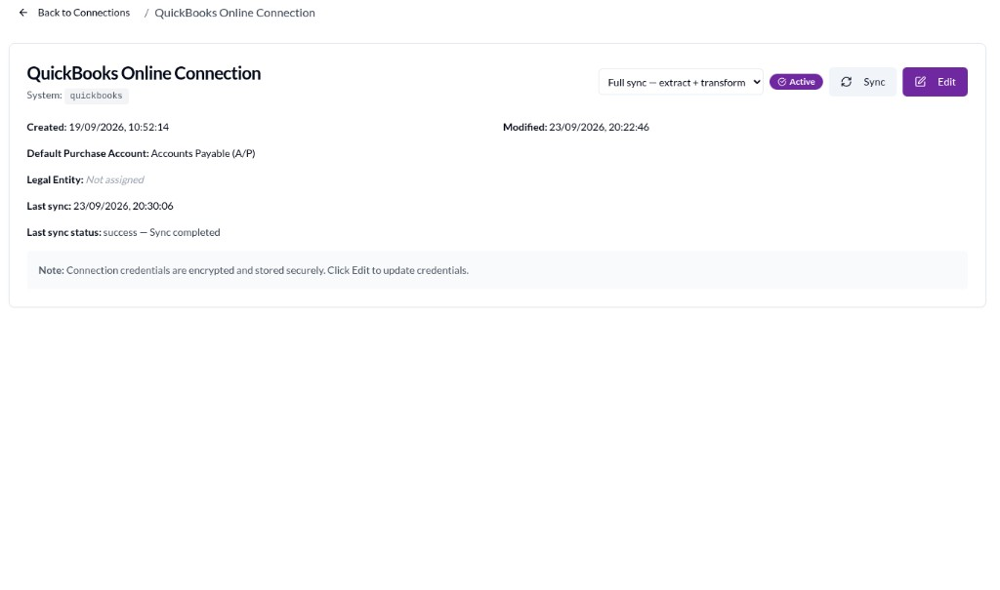

# QuickBooks Integration to Fabriq

**Audience:** PSO / engineers setting up QuickBooks Online → Fabriq  
**Scope:** Intuit OAuth, Airbyte extract, Fabriq connection, and Sync (extract + transform)  
**Last updated:** 2026-09-24

Related docs:

- [QUICKBOOKS_TO_FABRIQ_USER_GUIDE.md](./QUICKBOOKS_TO_FABRIQ_USER_GUIDE.md) — what syncs and field maps (business users)
- [QUICKBOOKS_FORWARD_SYNC.md](./QUICKBOOKS_FORWARD_SYNC.md) — technical forward-sync reference
- [INTEGRATIONS.md](./INTEGRATIONS.md) — platform architecture

> **Security:** Screenshots may show sandbox Client IDs / tokens. Never copy live secrets from docs. Rotate any credential that was shared outside a secure vault.

---

## Overview

You need **two separate Intuit Developer apps** (or two OAuth credential sets):

| Purpose | Where credentials are stored | Used for |
|---------|------------------------------|----------|
| **1. Airbyte QuickBooks source** | Airbyte → Sources → Fabriq QuickBooks | Extract raw QBO data into Fabriq Postgres (`datalake.qb_*`) |
| **2. Fabriq QuickBooks connection** | Fabriq → Settings → Connections | Test Connection, reverse API, and UI Sync orchestration |

```
Intuit App A (Airbyte)          Intuit App B (Fabriq)
        │                                │
        ▼                                ▼
 Airbyte Source ──► Connection ──► Destination (Fabriq DB / datalake)
        │
        │  (raw qb_* tables)
        ▼
 Fabriq Sync button ──► Extract (Airbyte) + Transform (DBT) ──► Fabriq UI
```

---

## Part 1 — Get OAuth credentials from Intuit Developer (Playground)

Do this **twice**: once for the Airbyte source app, once for the Fabriq connection app. Steps are the same; choose a **different app** each time.

### 1.1 Open OAuth 2.0 Playground

1. Go to [Intuit Developer](https://developer.intuit.com/) → **OAuth 2.0 Playground**.
2. **Select workspace** (e.g. `FABRIQ`).
3. **Select app** (e.g. `Test App (Sandbox)` for Airbyte, or your Fabriq-specific app).
4. Confirm **Client ID** and **Client Secret** are shown under OAuth Keys.
5. Under **Scopes**, check only:
   - `com.intuit.quickbooks.accounting`
6. Click **Get authorization code**.



### 1.2 Select the QuickBooks company

After authorization, Intuit asks which company to connect.

1. Search / select your company (e.g. **Sandbox Company US 181**).
2. Click **Next**.



### 1.3 Exchange authorization code for tokens

On **Step 2**, the playground shows:

- **Authorization Code**
- **Realm ID** (Company ID) — save this; you need it in both Airbyte and Fabriq

Click **Get tokens**.



### 1.4 Copy Access Token and Refresh Token

On **Step 3 / Step 4** you get:

| Value | Lifetime (typical) | Where you paste it |
|-------|--------------------|--------------------|
| **Realm ID** | Stable per company | Airbyte source + Fabriq connection |
| **Access Token** | ~60 minutes | Airbyte source (required by connector) |
| **Refresh Token** | ~100 days (rotates on refresh) | Airbyte source + Fabriq connection |
| **Client ID / Secret** | Until rotated | Airbyte source + Fabriq connection |



Keep these values for **App A** (Airbyte) or **App B** (Fabriq), depending on which app you selected.

---

## Part 2 — Configure the Airbyte QuickBooks source

Use credentials from **Intuit App A**.

1. Open Airbyte → **Sources**.
2. Open (or create) **Fabriq QuickBooks**.
3. Set:

   | Field | Value |
   |-------|--------|
   | Source name | e.g. `Fabriq QuickBooks` |
   | Realm ID | From playground |
   | Client ID | App A |
   | Client Secret | App A |
   | Access Token | From playground |
   | Refresh Token | From playground |
   | Token Expiry Date | From token response / playground |

4. Save the source.



---

## Part 3 — Create Airbyte destination (Fabriq database)

1. In Airbyte → **Destinations**, create or select a Postgres destination pointed at the Fabriq database (schema used for raw load is typically `datalake`).
2. Confirm the destination can write tables such as `qb_accounts`, `qb_invoices`, etc. (prefix configured in the next step).

*(Use your existing Fabriq / Quickbooks-dev destination if one already exists for this tenant.)*

---

## Part 4 — Create the Airbyte connection (source → destination)

### 4.1 Define source

1. Airbyte → **Connections** → **New connection**.
2. Choose **Select an existing source**.
3. Pick **Fabriq QuickBooks**.



### 4.2 Define destination

Select the Fabriq Postgres destination (e.g. **Quickbooks-dev** / fabriq DB).

### 4.3 Select streams

Recommended sync mode: **Replicate Source** with **Incremental | Append + Deduped** where available.

Enable at least the streams Fabriq transforms (adjust to tenant needs):

| Stream | Typical use in Fabriq |
|--------|------------------------|
| `accounts` | Chart of Accounts |
| `vendors` | Suppliers |
| `items` | Item Master |
| `invoices` | Sales invoices |
| `bills` | Purchase bills |
| `purchase_orders` | POs |
| `purchases` | Expenses / purchases |
| `tax_agencies` / `tax_codes` / `tax_rates` | Tax master |



### 4.4 Configure connection

Suggested settings (match your environment):

| Setting | Example |
|---------|---------|
| Connection name | `Fabriq QuickBooks → Quickbooks-dev` |
| Schedule type | **Manual** (Fabriq Sync button triggers jobs) |
| Destination Namespace | **Custom format** → `datalake` |
| Stream Prefix | `qb_` (so tables become `datalake.qb_invoices`, etc.) |
| Schema changes | Propagate field changes only (optional) |

Click **Set up connection**.



### 4.5 Optional: run a first Airbyte sync

From the connection page you can **Sync now** / **Test connection** to verify extract into `datalake.qb_*` before wiring Fabriq.

---

## Part 5 — Configure Fabriq QuickBooks connection (second Intuit app)

Use credentials from **Intuit App B** (repeat Part 1 with a **different** app if App A was used only for Airbyte).

1. Open Fabriq → **Settings → Connections**.
2. Open **QuickBooks Online Connection** → **Edit**.
3. Fill:

   | Field | Notes |
   |-------|--------|
   | Connection Name | e.g. `QuickBooks Online Connection` |
   | Legal Entity | Optional; accounts from sync can be assigned here |
   | Client ID | App B |
   | Client Secret | App B |
   | Refresh Token | From playground (App B) |
   | Company ID (Realm ID) | Same company as Airbyte (e.g. sandbox realm) |
   | Environment | `sandbox` or `production` |
   | Default Purchase Account | e.g. Accounts Payable (A/P) |

4. Click **Test Connection**, then **Save Connection**.



> **Also required for Sync:** `extraction_config` on the connection must include Airbyte API credentials + Airbyte **connection_id** (see [QUICKBOOKS_FORWARD_SYNC.md](./QUICKBOOKS_FORWARD_SYNC.md)). Without it, Test Connection can pass but **Sync** cannot start Airbyte jobs.

---

## Part 6 — Run Sync in Fabriq (extract + transform)

1. Open the saved QuickBooks connection.
2. Set sync mode to **Full sync — extract + transform**.
3. Click **Sync**.
4. Confirm **Last sync status** shows success.



---

## What “Extract + Transform” means

```
QuickBooks Online
       │
       ▼  EXTRACT (Airbyte)
datalake.qb_*          ← raw tables (qb_invoices, qb_vendors, …)
       │
       ▼  TRANSFORM (DBT)
Fabriq business tables ← customers, supplier, item_master, account, invoice, …
       │
       ▼
Fabriq UI / APIs / workflows
```

| Mode (UI) | What runs | When to use |
|-----------|-----------|-------------|
| **Full sync — extract + transform** | Airbyte job, then DBT | Normal “bring latest from QuickBooks into Fabriq” |
| **Extract only** | Airbyte only | Refresh raw `datalake.qb_*` without rewriting Fabriq models |
| **Transform only** | DBT only | Re-run mappings when raw data is already in `datalake` |

### Extract

- Airbyte authenticates to QuickBooks with the **source** OAuth credentials.
- It pulls selected streams and writes into Postgres (`datalake` + `qb_` prefix).
- Data is still in QuickBooks-shaped / raw form — not yet Fabriq entities.

### Transform

- DBT reads staging views (`stg_qbo_*` / equivalent), builds sync batches, and upserts into Fabriq models.
- Lineage (`source_system`, external IDs) is preserved so later syncs update the same rows.
- After transform succeeds, records appear under Sales / Purchases / Accounting / Masters as documented in the [user guide](./QUICKBOOKS_TO_FABRIQ_USER_GUIDE.md).

---

## Checklist

- [ ] Intuit App A credentials generated (playground) for Airbyte source
- [ ] Airbyte source saved (Realm ID, Client ID/Secret, Access + Refresh tokens)
- [ ] Airbyte destination points at Fabriq DB
- [ ] Airbyte connection created: streams selected, namespace `datalake`, prefix `qb_`
- [ ] Intuit App B credentials generated for Fabriq connection
- [ ] Fabriq Settings → Connections → QuickBooks: credentials saved + Test Connection OK
- [ ] `extraction_config` linked to Airbyte connection ID
- [ ] Full sync (extract + transform) succeeded in Fabriq
- [ ] Spot-check customers / vendors / accounts / invoices in Fabriq UI

---

## Troubleshooting (quick)

| Symptom | Check |
|---------|--------|
| Playground / token errors | Scope includes `com.intuit.quickbooks.accounting`; correct sandbox vs production app |
| Airbyte source auth fails | Refresh token expired/rotated; Realm ID matches selected company |
| Tables not in `datalake` | Destination namespace / stream prefix (`qb_`) |
| Fabriq Test Connection fails | App B Client ID/Secret/Refresh/Realm/environment |
| Sync button fails after Test OK | Missing or wrong `extraction_config` (Airbyte connection_id) |
| Extract OK but UI empty | Transform failed — check sync service / DBT logs |

For deeper ops detail, see [QUICKBOOKS_FORWARD_SYNC.md](./QUICKBOOKS_FORWARD_SYNC.md) and [RAILWAY_SYNC_SERVICE_IMPLEMENTATION.md](./RAILWAY_SYNC_SERVICE_IMPLEMENTATION.md).
