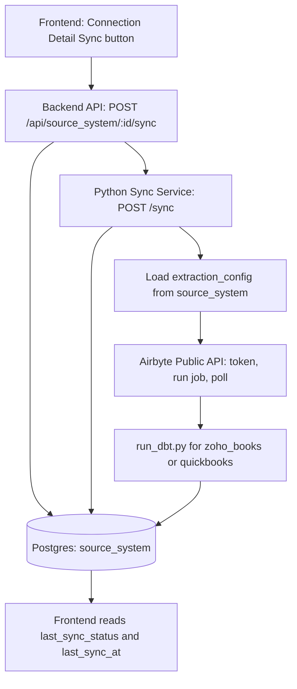

# Railway ERP Sync Service (Up-to-Date)

## What this implements

Manual ERP sync (Zoho Books + QuickBooks) triggered from Fabriq UI, executed asynchronously through backend + sync service:

- Frontend triggers sync for a connection.
- Backend marks status as `in_progress` and queues sync.
- Python sync service runs Airbyte + DBT in background.
- Final status is written back to `source_system.last_sync_status`.

---

## End-to-End flow



Plain text fallback:

```text
Frontend Sync Button
  -> Backend /api/source_system/:id/sync
      -> set source_system.last_sync_status = in_progress
      -> call Python /sync
          -> load source_system.extraction_config
          -> trigger Airbyte + wait
          -> run integration run_dbt.py
          -> update source_system.last_sync_status = success/error
  -> Frontend reads source_system.last_sync_status + last_sync_at
```

### Request/response behavior

1. Frontend calls backend sync endpoint with `sync_mode`.
2. Backend validates ownership, sets:
   - `last_sync_status = { status: "in_progress", ... }`
   - `last_sync_at = now()`
3. Backend calls sync service and returns immediately to frontend.
4. Sync service validates API key for org, runs workflow in background:
   - extract only (`extract_only`)
   - transform only (`transform_only`)
   - full sync (`full_sync`)
5. Sync service updates `source_system.last_sync_status` to `success` or `error` with detail.

---

## Components and files

### Frontend

- `frontend-1/src/api/api.ts`
  - `erpConnectionsAPI.triggerSync(id, syncMode)`
- `frontend-1/src/pages/settings/ConnectionDetailPage.tsx`
  - Sync button + mode select
  - disables sync button while `last_sync_status.status === "in_progress"`
- `frontend-1/src/pages/settings/ConnectionsPage.tsx`
  - shows last sync columns

### Backend (Node)

- `backend/src/rest/routes.ts`
  - `POST /api/source_system/:id/sync`
  - validates org + system
  - sets in-progress status
  - forwards request to Python service

### Sync service (Python)

Folder: `backend/integrations/sync_service/`

- `main.py`: API + background execution + status persistence
- `airbyte_client.py`: orchestration entrypoint
- `airbyte_connector.py`: Airbyte token/job/poll client
- `extraction_config_loader.py`: loads and decrypts per-connection Airbyte config
- `user_api_key_validator.py`: validates incoming user api key hash by org

---

## Data model

`source_system` includes:

- `last_sync_at` (`DateTime?`)
- `last_sync_status` (`Json?`)
- `extraction_config` (`Json?`) - encrypted at rest

Migration file:

- `backend/prisma/migration/2026-03-31/add_source_system.sql`

This single script adds `last_sync_at`, `last_sync_status`, and `extraction_config` (all `IF NOT EXISTS`). Older separate folders such as `2026-03-31_source_system_last_sync/` and `2026-03-31_source_system_extraction_config/` were removed and merged here—do not reference those paths.

---

## Sync modes

Supported `sync_mode` values:

- `full_sync` -> Airbyte + DBT
- `extract_only` -> Airbyte only
- `transform_only` -> DBT only

---

## How Airbyte credentials are configured now

Airbyte credentials are **not** read from sync service env anymore.
They are loaded per-connection from `source_system.extraction_config`.

Expected shape:

```json
{
  "type": "airbyte",
  "client_id": "...",
  "client_secret": "...",
  "connection_id": "...",
  "api_base": "https://api.airbyte.com"
}
```

Notes:

- `connection_id` here means Airbyte connection UUID.
- `api_base` is optional (defaults to `https://api.airbyte.com`).
- `extraction_config` is encrypted/decrypted by existing Prisma middleware and shared encryption utility.

---

## ERP + extraction config setup

### 1) Ensure schema/migration is applied

From `backend/` run your migration flow, then:

```bash
npx prisma generate
```

### 2) Set extraction config per source_system via script

Script:

- `backend/scripts/set-extraction-config.ts`

Run from `backend/`:

```bash
export AIRBYTE_CLIENT_ID="your_airbyte_client_id"
export AIRBYTE_CLIENT_SECRET="your_airbyte_client_secret"
# optional override
export AIRBYTE_API_BASE="https://api.airbyte.com"

ts-node scripts/set-extraction-config.ts \
  --source-system-id "srcsys_xxx" \
  --airbyte-connection-id "airbyte_connection_uuid"
```

This writes encrypted `extraction_config` for that connection.

---

## Local sync service setup

From `backend/integrations`:

```bash
python3 -m venv .venv
source .venv/bin/activate
pip install -r sync_service/requirements.txt
set -a && source sync_service/.env && set +a
PYTHONPATH=. uvicorn sync_service.main:app --host 0.0.0.0 --port 8080
```

Required in `sync_service/.env`:

- `DATABASE_URL` (or DB_HOST/DB_PORT/DB_USER/DB_PASSWORD/DB_NAME)
- `ERP_CONFIG_ENCRYPTION_KEY` (must match backend key exactly)

Optional:

- `AIRBYTE_API_BASE`
- `SKIP_AIRBYTE=true`
- `DBT_SUBPROCESS_TIMEOUT_SEC`

---

## Railway deployment setup

Deploy `backend/integrations/sync_service` (Dockerfile-based service).

### Railway env vars (sync service)

Required:

- `DATABASE_URL`
- `ERP_CONFIG_ENCRYPTION_KEY`

Optional:

- `AIRBYTE_API_BASE`
- `DBT_SUBPROCESS_TIMEOUT_SEC`
- `SKIP_AIRBYTE`

### Backend env vars

Backend must have:

- `INTEGRATION_SYNC_URL` (Railway sync service URL)

### Key compatibility checklist

- `ERP_CONFIG_ENCRYPTION_KEY` in backend and sync service must be identical.
- If keys mismatch or missing, sync fails while decrypting `extraction_config`.

---

## Status model (what UI shows)

Example `in_progress`:

```json
{
  "status": "in_progress",
  "message": "Sync in progress",
  "sync_mode": "full_sync",
  "started_at": "2026-03-31T12:00:00Z"
}
```

Example `success`:

```json
{
  "status": "success",
  "message": "Sync completed",
  "sync_mode": "full_sync",
  "synced_at": "2026-03-31T12:05:00Z",
  "detail": {
    "airbyte": {},
    "dbt": {},
    "total_duration_ms": 300000
  }
}
```

Example `error`:

```json
{
  "status": "error",
  "message": "Failed to decrypt extraction_config: ...",
  "sync_mode": "full_sync",
  "synced_at": "2026-03-31T12:00:10Z"
}
```

---

## Troubleshooting quick list

- `ERP_CONFIG_ENCRYPTION_KEY environment variable not set`
  - sync service env not loaded into uvicorn process.
- `Failed to decrypt extraction_config`
  - wrong key between backend and sync service, or corrupted encrypted data.
- Airbyte 4xx/5xx
  - verify Airbyte app credentials and connection UUID in `extraction_config`.
- Route hitting relation endpoint instead of sync endpoint
  - ensure `/source_system/:id/sync` route is registered before generic relation routes.
