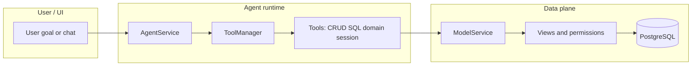

# Session: Agentic Features — Basics (LLM, Tools & Data Access)

**Duration**: 3–4 hours (self-study can be spread over two sessions)  
**Objective**: Understand how Fabriq Books wires LLMs to your org’s data through `AgentService`, the tool layer, and metadata-driven CRUD — including “simple” CRUD tools vs advanced analytics and domain tools — **and** the industry concepts (tool calling, multi-step agents, trust boundaries) that make this design sensible.

**Prerequisites**:

- [ ] Backend runs locally (`cd backend && npm run dev`, port 4000)
- [ ] You have read [Session 2 Workbook](./ONBOARDING_SESSION2_WORKBOOK.md) or equivalent familiarity with Prisma models, views, and permissions
- [ ] `AGENT`/LLM-related env vars configured if you want to run live agent calls (see [docs/AI_AGENT.md](../AI_AGENT.md))

**Fabriq deep references**:

- [docs/AI_AGENT.md](../AI_AGENT.md) — metadata and agent context
- [docs/agent/07-WORKED_EXAMPLES.md](../agent/07-WORKED_EXAMPLES.md) — reconciliation and categorization traces
- [docs/agent/05-TOOLS.md](../agent/05-TOOLS.md#categorizepostings) — categorization batch handler used by the agent tool

---

## Table of contents

1. [Why this session exists](#1-why-this-session-exists)
2. [Conceptual foundations (from the field)](#2-conceptual-foundations-from-the-field)
3. [How Fabriq maps those ideas](#3-how-fabriq-maps-those-ideas)
4. [Mental model (architecture)](#4-mental-model-architecture)
5. [Key files (map the codebase)](#5-key-files-map-the-codebase)
6. [AgentService: responsibilities](#6-agentservice-responsibilities)
7. [“Simple” tools: schema-driven CRUD and search](#7-simple-tools-schema-driven-crud-and-search)
8. [Advanced SQL: `advancedSqlQuery` vs `analyticsQuery`](#8-advanced-sql-advancedsqlquery-vs-analyticsquery)
9. [Domain tools on `posting`](#9-domain-tools-on-posting)
10. [Session-only tools (bridge to Workbench)](#10-session-only-tools-bridge-to-workbench)
11. [Trust, safety, and multi-tenancy](#11-trust-safety-and-multi-tenancy)
12. [Hands-on checklist](#12-hands-on-checklist)
13. [Self-study questions](#13-self-study-questions)
14. [Glossary](#14-glossary)
15. [Curated study materials (external)](#15-curated-study-materials-external)
16. [Optional: E2E tests](#16-optional-e2e-tests)

---

## 1. Why this session exists

Modern “agent” features are often explained only at the **file** level (“this class calls that one”). That is necessary but not sufficient. To debug behaviour, extend tools safely, or explain the product to others, you also need a **conceptual** layer:

- What is **tool calling** in LLMs, and how does it differ from stuffing context into the prompt?
- Why do frameworks use **multi-step** loops instead of one-shot answers?
- Where is the **trust boundary**: what does the model *decide*, and what does *your code* enforce?

This workbook mixes **industry-standard explanations** (with external readings) and **Fabriq-specific wiring** (`AgentService`, `ToolManager`, `ModelService`).

---

## 2. Conceptual foundations (from the field)

### 2.1 Tool calling (function calling) in one paragraph

Large language models do not “run SQL” or “hit your API” by themselves. Providers expose **tool calling** (also called **function calling**): the model emits structured output that names a tool and supplies arguments (often JSON). Your runtime **validates** those arguments against a schema, **executes** a function you wrote, and **returns** the result to the model as a *tool result* so it can continue reasoning or answer the user.

The Vercel AI SDK documents this pattern explicitly: tools combine a **description**, an **input schema** (e.g. Zod) consumed by both the model and your validator, and an **`execute`** function that returns the tool result ([AI SDK Core: Tool Calling](https://sdk.vercel.ai/docs/ai-sdk-core/tools-and-tool-calling)). The doc also distinguishes a **tool call** (model output) from the **tool result** (your function’s return value).

**Study**: Read the “Tool Calling” overview and the `generateText` / `streamText` examples in the same document — it is the conceptual backbone of `AgentService`.

### 2.2 Multi-step agents and stopping conditions

Single-shot generation (`maxSteps: 1` in many setups) answers in one model pass. **Multi-step** tool use means: model may call a tool → your code runs → result goes back → model may call another tool or produce a final answer. Frameworks loop until a **stopping condition** (e.g. step count, or “no more tool calls”).

The AI SDK discusses multi-step flows and step limits in its tool-calling guide; in Fabriq, analogous limits are **`AGENT_MAX_STEPS`** (default 5) and **`SESSION_MAX_STEPS`** (default 20) for session-backed runs — see [§6](#6-agentservice-responsibilities).

**Practical note (any framework)**: Forcing a tool on *every* step (`toolChoice: 'required'` in some APIs) combined with a multi-step loop can create **non-termination** if the model never emits a final text answer. Fabriq avoids brittle routing by exposing a **unified** tool set rather than stripping tools based on a classifier (see §6).

### 2.3 RAG vs tool use — when people compare them

**Retrieval-Augmented Generation (RAG)** usually means: retrieve chunks from a knowledge base (vector DB, documents), inject them into the prompt, then generate. It excels at **grounded explanations** and **citations** over semi-static corpora.

**Tool use** means: the model selects **named operations** with **typed arguments**; your backend performs **live** actions (query DB, call APIs, enqueue work).

Industry write-ups often recommend **combining** them: e.g. retrieve policy docs, then call tools to fetch live balances or post transactions. See for example [Stream’s discussion of RAG vs function calling](https://getstream.io/blog/rag-function-calling/) and broader comparisons in vendor/educational content (e.g. [DigitalOcean’s engineers’ guide touching RAG vs MCP/tools](https://www.digitalocean.com/community/tutorials/engineers-guide-rag-vs-mcp-llms)).

**How Fabriq fits**: The Books agent is predominantly **tool-driven live data access**, not “embeddings over PDFs.” Metadata and prompts give the model *schema awareness*; **`ModelService`** and SQL tools give **fresh, permission-checked** data. That is closer to **enterprise tool use** than to classic document RAG — though you could add RAG later for help docs or policy text.

### 2.4 Enterprise framing: why tools beat “prompt the whole database”

Enterprise-oriented guides emphasize that tool calling turns natural language into **validated, auditable actions** integrated with existing systems (see e.g. [StackAI’s overview of function calling for enterprise automation](https://www.stack-ai.com/insights/function-calling-in-llms-the-essential-guide-for-enterprise-ai-automation)). Fabriq aligns with that: the LLM never receives unrestricted SQL execution without going through **`modelService.executeSqlQuery`** / analytics layers that enforce **org** and **permissions**.

---

## 3. How Fabriq maps those ideas

| Industry idea | Fabriq implementation |
|---------------|------------------------|
| Tool schema + execute | `tool()` in `AgentTools.ts` / `tools/*.ts`, Zod in `GenericFunctions.ts` |
| Multi-step loop | `generateText` / `streamText` with step budget (`AGENT_MAX_STEPS`, `SESSION_MAX_STEPS`) |
| Grounded business data | `ModelService.search/create/update`, not raw model weights |
| “Human in the loop” for risky writes | `categorizePostings` **dry_run**; writes via **pending actions** + executors (Workbench) |
| Live observability | `classifyQuestion` for logging; traces/session events elsewhere |

---

## 4. Mental model (architecture)

Fabriq’s agent is **not** a separate database user with superpowers. It is a **Vercel AI SDK**–driven loop (`generateText` / `streamText`) that:

1. Builds a **system prompt** from accessible models, optional focus models, and (in sessions) **agent templates**.
2. Exposes **tools** (TypeScript wrappers with Zod schemas) the model can call.
3. Routes data access through **`ModelService`** — the same path as REST CRUD — so **views and permissions** still apply.

So: **Prisma → auto API → views/permissions** is the same story; the agent calls tools that delegate to `ModelService` instead of HTTP.



---

## 5. Key files (map the codebase)

| Area | Location |
|------|----------|
| Request handling, prompts, streaming, session/template merge | `backend/src/agent/AgentService.ts` |
| Which tools exist per “model context” + unified + session tools | `backend/src/agent/ToolManager.ts` |
| CRUD/search/SQL/ERP tool implementations | `backend/src/agent/AgentTools.ts` |
| Zod schemas & generic function descriptions | `backend/src/agent/GenericFunctions.ts` |
| Session/workbench tools (plan, steps, queue actions) | `backend/src/agent/tools/` (e.g. `sessionTools.ts`, `categorizePostings.ts`) |
| HTTP routes (chat, sessions, SSE) | `backend/src/agent/routes.ts` |
| Model provider (which LLM) | `backend/src/lib/ai/modelProvider.ts` |

---

## 6. AgentService: responsibilities

`AgentService`:

- Resolves **accessible models** from the user’s permissions (`ModelRegistry`).
- Builds the **system prompt** via `DynamicPromptManager` (and merges **template** `system_prompt` when `agent_session.template_id` is set).
- For sessions, derives **`goal_model`** into context so the prompt focuses on the right entities (see `RELATED_MODELS` in `AgentService.ts`).
- Uses **`ToolManager.getUnifiedTools(modelName, auth, context, sessionId)`** so the model gets:
  - Model-specific tools (CRUD, search, domain tools),
  - **Analytics** tools (`getAnalyticsContext`, `analyticsQuery`),
  - **Session tools** only when `sessionId` is present (`createPlan`, `completeStep`, `queueAction`, `queueActionBatch`).

**Observability**: `classifyQuestion` may run for logging; routing does **not** strip tools based on classification — the **unified** tool set avoids misclassification cutting off needed tools (a common failure mode in classifier-based routing).

**Configurable limits**: `AGENT_MAX_STEPS` (default 5) for non-session calls; `SESSION_MAX_STEPS` (default 20) when a session id is present.

---

## 7. “Simple” tools: schema-driven CRUD and search

These tools wrap **`ModelService`**, which enforces the same rules as the generated REST layer:

| Tool | Role |
|------|------|
| `searchRecords` | Paginated search with filters; any model the user can access |
| `createRecord` | Create; `org_id` and permission checks apply |
| `updateRecord` | Update by id |
| `createChildItem` / `updateChildItem` | Line items on structured parents (e.g. PR lines) |

**Why this matters for onboarding**: When you add a Prisma model and wire views/permissions, **you do not hand-write agent CRUD** — the agent uses generic tools + metadata. `createRecordTool` / `updateRecordTool` in `AgentTools.ts` call `modelService.create` / `modelService.update` and return **enriched** results (columns, `uiHint`, optional action links) for the UI or the next LLM step.

**Connection to AI SDK concepts**: Each tool’s **description** in `GenericFunctions.ts` is part of the “contract” documented in public tool-calling guides — the model uses descriptions to choose *when* to call a tool; your code enforces *what* actually runs.

**Exercise (read-only)**:

1. Open `AgentTools.ts` → `createRecordTool` and trace `modelService.create`.
2. In `ToolManager.getToolsForModel`, note how **`posting`** differs from **`purchase_requisition`** (extra domain tools, fewer related search helpers).

---

## 8. Advanced SQL: `advancedSqlQuery` vs `analyticsQuery`

Both execute SQL in a controlled way, but they are aimed at different **interaction patterns**:

### `advancedSqlQuery` (`AgentTools.ts`)

- Parameters include natural-language **`description`**, SQL **`query`**, optional **`uiHint`** (e.g. table vs metrics display).
- Implementation: `modelService.executeSqlQuery(query, auth)` — must respect org and permission rules in that layer.
- Included for most model tool sets in `ToolManager` (including `default` and `posting`).

### `getAnalyticsContext` + `analyticsQuery` (`backend/src/agent/tools/`)

- Added via **`getUnifiedTools`** for every agent run alongside model tools.
- Suited to **multi-step analytical** questions: schema context first, then permission-aware SQL (`analyticsQuery`).
- `ToolManager.getToolsForClassification` still exposes analytics-only sets for legacy paths, but the main agent path uses the **unified** bundle.

**Conceptual distinction**: Think of **`getAnalyticsContext`** as “what am I allowed to know about the schema and joins?” and **`analyticsQuery`** as “run this analytical SQL under those rules.” **`advancedSqlQuery`** is still a single tool with rich presentation hints (`uiHint`) for answers that might be ad hoc reporting or exploration within the same guardrails.

**Exercise**: Skim `analyticsQuery.ts` and compare error handling and result shaping to `advancedSqlQueryTool` — notice both aim for safe, explainable outputs.

---

## 9. Domain tools on `posting`

When `modelName === 'posting'`, the tool set adds:

| Tool | Purpose |
|------|---------|
| `suggestReconciliationMatches` | Suggests bank ↔ receipt/invoice matches; see [07-WORKED_EXAMPLES.md — Trace 2](../agent/07-WORKED_EXAMPLES.md#trace-2-reconciliation-atpl_reconcile) |
| `categorizePostings` | Wraps `categorizeTransactionBatchHandler` with **`dry_run: true`** — returns predictions only (no DB writes). The agent then uses `queueAction` / `queueActionBatch` with `categorize_transaction` for human approval in the workbench |

**Important**: `categorizePostings` is intentionally **non-destructive** in one shot. Writes happen after approval via **pending action executors** (`CategorizeTransactionExecutor` in `PendingActionExecutor.ts`).

This mirrors the AI SDK’s general idea that **dangerous** tools can require explicit approval in the framework ([Tool Execution Approval](https://sdk.vercel.ai/docs/ai-sdk-core/tools-and-tool-calling) in the same doc). Fabriq implements approval at the **product** layer (Workbench pending actions), not only inside a single `generateText` call.

---

## 10. Session-only tools (bridge to Workbench)

When `sessionId` is passed into `getUnifiedTools`:

- `createPlan` / `completeStep` — structured plan execution (hybrid dispatcher can run deterministic steps without an LLM — see the Workbench workbook).
- `queueAction` / `queueActionBatch` — enqueue **pending actions** for user approval.

These connect the chat/agent loop to the **Workbench** UX. The next session document covers lifecycle, SSE, and inbox: [ONBOARDING_SESSION_AGENTIC_WORKBENCH_WORKBOOK.md](./ONBOARDING_SESSION_AGENTIC_WORKBENCH_WORKBOOK.md).

---

## 11. Trust, safety, and multi-tenancy

**Principles to internalize**:

1. **The model proposes; the server disposes.** Tool arguments are not trusted until validated; business rules live in `ModelService`, executors, and DB constraints.
2. **Org isolation** is not optional — every tool path should respect the same `org_id` and permission model as REST.
3. **Destructive or high-impact operations** (ledger changes, categorization) should go through paths you can audit — hence dry-run tools + pending actions for many flows.

**Contrast with “open” chatbots**: Giving an LLM a raw read-only SQL session or full API keys in the prompt would violate enterprise expectations. Fabriq’s design keeps **capability** in tools and **authorization** in shared services.

---

## 12. Hands-on checklist (developer)

- [ ] Trace one `handleRequest` or `handleStreamingRequest` path in `AgentService.ts` from entry to `generateText` / `streamText`.
- [ ] List tools returned for `getUnifiedTools('posting', auth, {}, '<session-id>')` by reading `ToolManager.ts` (paper exercise).
- [ ] Open `GenericFunctions.ts` and find the description string for `advancedSqlQuery` — this text is what the **model** sees.
- [ ] Read `categorizePostings.ts` top-of-file comment — confirm dry-run vs approval flow.

---

## 13. Self-study questions

Answer in your own words (notes are enough):

1. **Why** does Fabriq expose a *unified* tool set instead of switching tool sets purely from `classifyQuestion`?
2. What is the difference between a **tool call** and a **tool result** in the AI SDK terminology, and where does each appear in a multi-step run?
3. Why is **`categorizePostings`** implemented as dry-run first instead of writing categories immediately?
4. Name one reason **`advancedSqlQuery`** and **`analyticsQuery`** might both exist instead of a single SQL tool.
5. If a new developer added a tool that bypassed `ModelService` and used Prisma directly, what could go wrong?

---

## 14. Glossary

| Term | Meaning |
|------|--------|
| **Tool calling / function calling** | Model outputs structured selection of a function + arguments; server runs validated code. |
| **Tool result** | The return value from your `execute` function, sent back into the model loop. |
| **RAG** | Retrieval-augmented generation — typically retrieve documents, then generate; distinct from live API tools. |
| **`ModelService`** | Fabriq’s shared service for permission-aware CRUD/search aligned with views. |
| **`goal_model`** | Session field narrowing which business domain the agent should focus on (e.g. `posting`). |
| **Dry run** | Compute predictions or candidates without committing side effects (e.g. categorization). |
| **Pending action** | User-reviewable proposal created by session tools before executors apply changes. |

---

## 15. Curated study materials (external)

Use these to build intuition beyond this repo. **URLs are authoritative as of writing; if a link moves, search for the article title.**

| Topic | Resource | Why read it |
|-------|----------|-------------|
| AI SDK tool calling | [Vercel AI SDK — Tool Calling](https://sdk.vercel.ai/docs/ai-sdk-core/tools-and-tool-calling) | Official definitions: tools, tool calls vs results, multi-step, approval |
| AI SDK foundations | [AI SDK — Tools (foundations)](https://sdk.vercel.ai/docs/foundations/tools) | Schemas, tool design |
| RAG vs function calling | [Stream — RAG vs Function Calling](https://getstream.io/blog/rag-function-calling/) | When retrieval fits vs when tools fit |
| RAG vs MCP / tools (perspective) | [DigitalOcean — Engineer’s guide: RAG vs MCP](https://www.digitalocean.com/community/tutorials/engineers-guide-rag-vs-mcp-llms) | Broader landscape of extending LLMs |
| Enterprise automation | [StackAI — Function calling in LLMs](https://www.stack-ai.com/insights/function-calling-in-llms-the-essential-guide-for-enterprise-ai-automation) | Business framing for tool use |

**Fabriq docs to read next**:

- [ONBOARDING_SESSION_AGENTIC_WORKBENCH_WORKBOOK.md](./ONBOARDING_SESSION_AGENTIC_WORKBENCH_WORKBOOK.md)
- [WORKBENCH_FUNCTIONAL_SPEC.md](../WORKBENCH_FUNCTIONAL_SPEC.md) (product behaviour)
- [WORKBENCH_IMPLEMENTATION_PLAN.md](../WORKBENCH_IMPLEMENTATION_PLAN.md) (what was built where)

---

## 16. Optional: run E2E tests

With DB + API keys available:

```bash
cd backend
npx jest src/agent/__tests__/v2-analytical-e2e.test.ts --runInBand --forceExit
```

Prerequisites often include demo data and seeded templates; see [WORKBENCH_IMPLEMENTATION_PLAN.md](../WORKBENCH_IMPLEMENTATION_PLAN.md) Phase 1 tests.

---

**Next**: [Workbench session workbook](./ONBOARDING_SESSION_AGENTIC_WORKBENCH_WORKBOOK.md) — sessions, SSE, templates, inbox, and hybrid execution.
